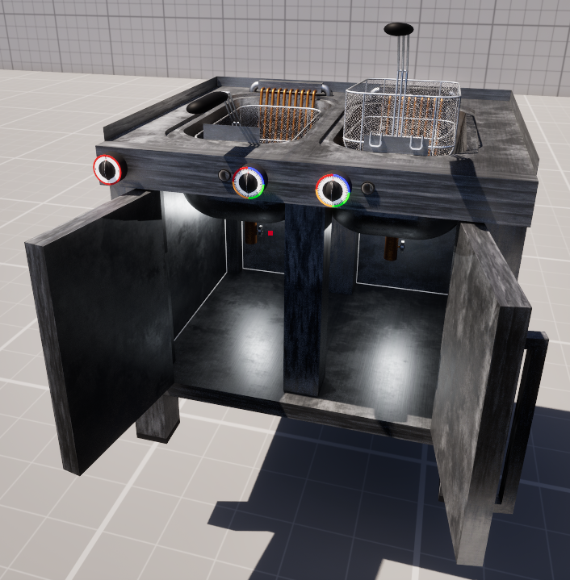
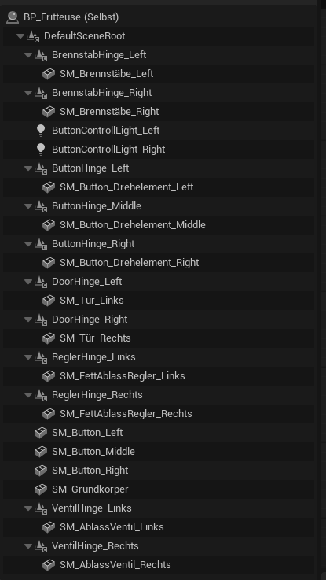
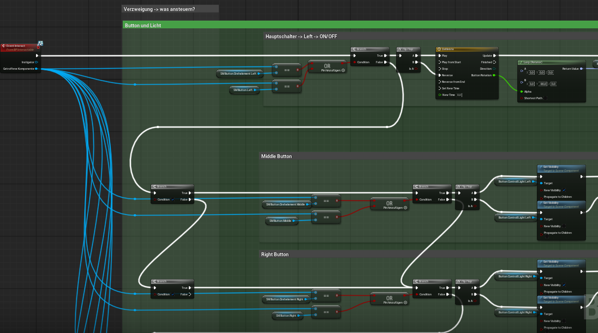
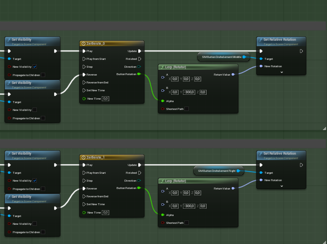
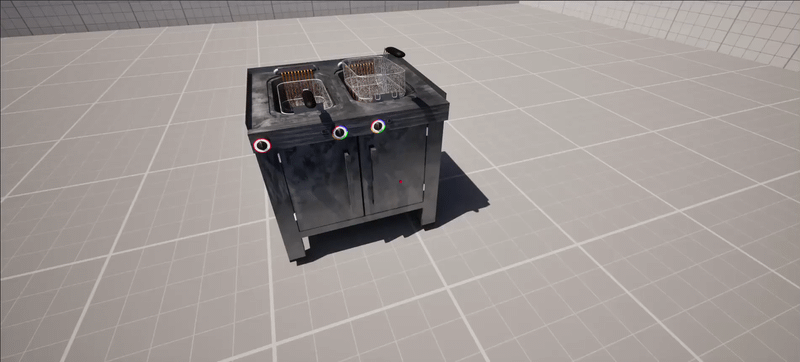

# BP_Fritteuse

Ein Unreal-Engine-Lernprojekt: eine interaktive Fritteuse, deren Bedienelemente und bewegliche Bauteile über Blueprints gesteuert und animiert werden.

> **Projektstatus:** Übungsprojekt im Aufbau. Weitere Medien und Dokumentationen werden ergänzt.

## Überblick

Der Blueprint `BP_Fritteuse` nutzt das Unreal-Blueprint-Interface `BPI_Interactable` und dessen Funktion `Interact`, um verschiedene Bauteile der Fritteuse interaktiv zu bedienen.

Anhand der getroffenen Komponente wird ermittelt, welches Bedienelement betätigt wurde. Je nach Komponente werden unterschiedliche Aktionen ausgelöst. Dazu gehören das Schalten von Kontrollleuchten sowie das Öffnen, Schließen und Bewegen verschiedener Bauteile.

Die Zustandswechsel und Bewegungsabläufe werden mithilfe von FlipFlop-Knoten und Timelines umgesetzt.

## Funktionen

- **Bedienelemente:** Hauptschalter sowie mittlerer und rechter Knopf lassen sich betätigen.
- **Kontrollleuchten:** Werden abhängig vom jeweiligen Schaltzustand ein- und ausgeblendet.
- **Türen:** Linke und rechte Tür lassen sich öffnen und schließen.
- **Heizstäbe:** Linke und rechte Brennstäbe können angehoben und abgesenkt werden.
- **Fettablasser:** Das Bedienelement lässt sich öffnen und schließen.

## Technische Umsetzung

- **Blueprint:** `BP_Fritteuse`
- **Interaktion:** Unreal-Blueprint-Interface `BPI_Interactable` mit der Funktion `Interact`
- **Komponentenprüfung:** Ermittlung des betätigten Bauteils anhand der getroffenen Komponente
- **Verzweigungslogik:** Verwendung von Branch- und OR-Knoten zur Prüfung verschiedener Interaktionsbedingungen
- **Zustandswechsel:** FlipFlop-Knoten zum Umschalten zwischen zwei Zuständen
- **Animation:** Timelines, Rotationsinterpolation und relative Komponentenrotation
- **Drehpunkte:** Eigene Hinge-Komponenten zur Festlegung der Rotationsachsen beweglicher Bauteile

## Screenshots

### 1. Komponentenstruktur

Übersicht über die Komponenten des `BP_Fritteuse`-Actors.

### 2. Interaktionslogik

Einstiegspunkt über das Event `Interact` des Interfaces `BPI_Interactable` sowie die Verzweigungslogik für den Hauptschalter, den mittleren und den rechten Knopf.

### 3. Actor-Aufbau und Drehpunkte

Aufbau des Actors mit den statischen Meshes, Kontrollleuchten und den selbst angelegten Drehpunkten (`Hinge_*`) für bewegliche Bauteile.

## Videos

### 1. Blueprint-EventGraph

Übersicht über den vollständigen EventGraph und die Umsetzung der verschiedenen Interaktionen.

<video src="resources/eventgraph.mp4" controls width="100%"></video>

### 2. Interaktionen im Viewport

Vorführung der Fritteuse in der laufenden Unreal-Engine-Szene mit den verschiedenen Bedienelementen und Animationen.

## Voraussetzungen und Verwendung

- **Unreal-Engine-Version:** Unreal Engine 5.8.4
- Das Interface `BPI_Interactable` muss im Projekt vorhanden sein.
- `BP_Fritteuse` muss in einer passenden Szene platziert werden.
- Die Interaktion erfolgt über das im Projekt vorhandene Interaktionssystem.
- Die konkrete Eingabe bzw. Taste wird durch das Interaktionssystem vorgegeben.

## Was ich dabei umgesetzt habe

- Interaktionen über ein Blueprint-Interface
- Erkennung unterschiedlicher Bauteile anhand der getroffenen Komponente
- Aufbau und Strukturierung eines Actors mit zahlreichen Komponenten
- Einrichtung eigener Drehpunkte für bewegliche Bauteile
- Steuerung animierter Bewegungsabläufe mit Timelines
- Umsetzung von Zustandswechseln für verschiedene Bedienelemente und bewegliche Teile

## Hinweise

Bei diesem Repository handelt es sich um eine Dokumentation des Übungsprojekts. Die Screenshots und Videos veranschaulichen den Aufbau und die Funktionsweise der Blueprints.

Ein Export des EventGraphs ersetzt nicht das vollständige Unreal-Engine-Projekt mit seinen Meshes, Materialien und weiteren Abhängigkeiten.