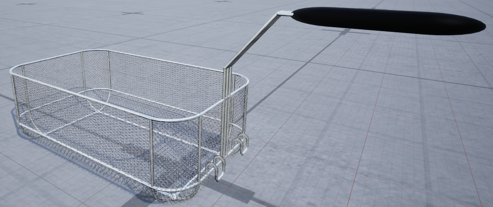
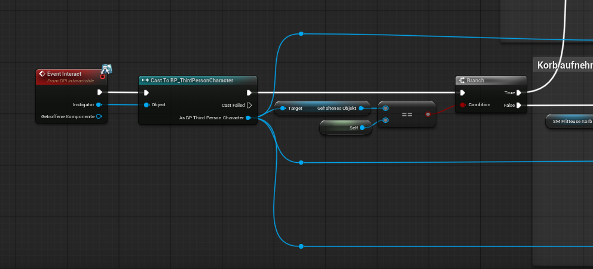
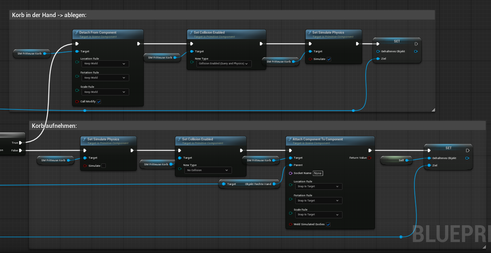
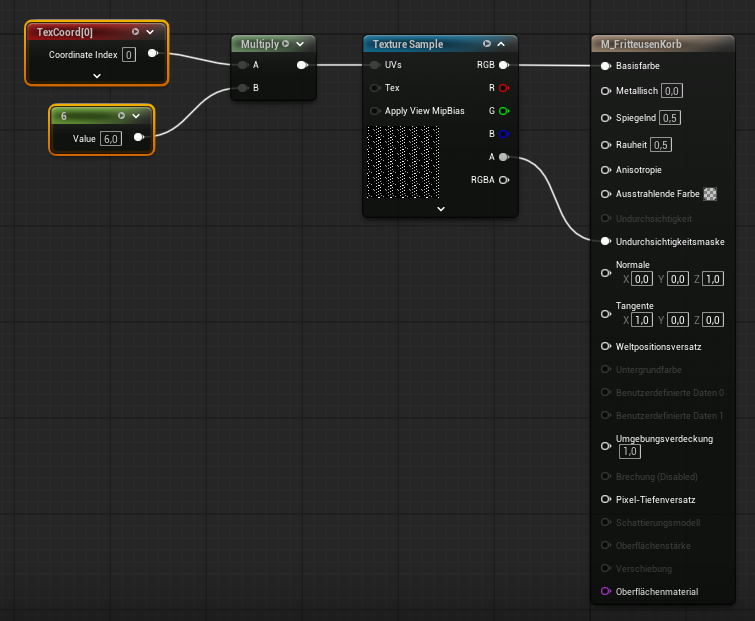

# BP_FritteuseKorb

Ein Unreal-Engine-Lernprojekt: ein interaktiver Fritteusenkorb, der aufgenommen, getragen und wieder abgelegt werden kann. Ergänzend wurde ein eigenes Material erstellt, das die typische Gitterstruktur des Korbs darstellt.

> **Projektstatus:** Übungsprojekt im Aufbau. Weitere Medien und Dokumentationen werden ergänzt.

## Überblick

Der Blueprint `BP_FritteuseKorb` nutzt das Unreal-Blueprint-Interface `BPI_Interactable` und dessen Funktion `Interact`, um das Aufnehmen und Ablegen des Fritteusenkorbs zu ermöglichen.

Beim Aufnehmen wird geprüft, ob der Korb bereits als `GehaltenesObjekt` im Character hinterlegt ist. Ist das der Fall, wird er wieder losgelassen. Andernfalls wird er an der vorgesehenen Haltekomponente der rechten Hand befestigt.

Während des Tragens werden Physiksimulation und Kollision deaktiviert. Beim Ablegen wird die Verbindung gelöst und Physik sowie Kollision werden wieder aktiviert.

Ergänzend wurde das Material `M_FritteusenKorb` erstellt, das mithilfe einer Gittertextur und einer Alphamaske die typische Korbstruktur darstellt.

## Funktionen

- **Aufnehmen:** Der Korb wird an der vorgesehenen Haltekomponente des Characters befestigt.
- **Tragen:** Während des Haltens sind Physiksimulation und Kollision des Korb-Meshes deaktiviert.
- **Ablegen:** Der Korb wird von der Haltekomponente gelöst. Seine Welttransformation bleibt dabei erhalten.
- **Physik und Kollision:** Nach dem Loslassen werden Physiksimulation und Kollision für Abfragen und Physik wieder aktiviert.
- **Zustandsverwaltung:** Beim Aufnehmen wird der Korb als `GehaltenesObjekt` gespeichert. Beim Ablegen wird die Referenz geleert.
- **Korbmaterial:** Eine Gittertextur mit Alphamaske und skalierten UV-Koordinaten dient zur Darstellung der Korboberfläche.

## Technische Umsetzung

- **Blueprint:** `BP_FritteuseKorb`
- **Interaktion:** Unreal-Blueprint-Interface `BPI_Interactable` mit der Funktion `Interact`
- **Character-Zugriff:** Cast des `Instigator` auf `BP_ThirdPersonCharacter`
- **Zustandsprüfung:** Vergleich der Variable `GehaltenesObjekt` mit `Self` und anschließende Branch-Verzweigung
- **Befestigung:** `Attach Component To Component` für `SM_Fritteuse_Korb` an `Objekt_Rechte_Hand`; Position, Rotation und Skalierung verwenden `Snap to Target`
- **Lösen:** `Detach From Component` mit `Keep World` für Position, Rotation und Skalierung
- **Physiksteuerung:** `Set Simulate Physics` zum Deaktivieren und Aktivieren der Physiksimulation
- **Kollisionssteuerung:** `Set Collision Enabled` mit `No Collision` beim Tragen und `Query and Physics` nach dem Ablegen
- **Material:** `M_FritteusenKorb` mit Gittertextur; RGB liefert die Basisfarbe, Alpha wird mit der Undurchsichtigkeitsmaske verbunden
- **Texturskalierung:** `Texture Coordinate` wird über einen `Multiply`-Knoten mit dem konstanten Faktor `6` multipliziert und an die UV-Eingabe des Texture Samples übergeben

## Screenshots

### 1. Interaktionslogik und Zustandsprüfung

Einstiegspunkt über das Event `Interact` des Interfaces `BPI_Interactable`, Cast auf den Character und Prüfung, ob dieser Korb bereits als `GehaltenesObjekt` gespeichert ist.

### 2. Aufnehmen und Ablegen

Die beiden Ausführungspfade für das Befestigen und Lösen des Korb-Meshes sowie das Umschalten von Physiksimulation, Kollision und Objektreferenz.

### 3. Materialaufbau

Aufbau des Materials `M_FritteusenKorb` mit Gittertextur, Alphamaske und skalierter Texturkoordinate.

## Voraussetzungen und Verwendung

- **Unreal-Engine-Version:** Unreal Engine 5.8.4
- Das Interface `BPI_Interactable` muss im Projekt vorhanden sein.
- Der Blueprint setzt `BP_ThirdPersonCharacter` mit der Variable `GehaltenesObjekt` und der Haltekomponente `Objekt_Rechte_Hand` voraus.
- `BP_FritteuseKorb` muss mit dem Korb-Mesh in einer passenden Szene platziert werden.
- Das Korb-Mesh benötigt eine für die Physiksimulation geeignete Kollisionskonfiguration.
- Für das Material werden die verwendete Gittertextur mit Alphakanal und ein passendes UV-Mapping benötigt.
- Der Blend Mode des Materials muss auf `Masked` eingestellt sein, damit die Alphamaske sichtbare Aussparungen erzeugt.
- Die Interaktion erfolgt über das vorhandene Interaktionssystem, das den Character als `Instigator` übergibt.
- Die konkrete Eingabe bzw. Taste wird durch das Interaktionssystem vorgegeben.

## Was ich dabei umgesetzt habe

- Interaktionen über ein Blueprint-Interface
- Zugriff auf Character-Komponenten und Variablen über einen Cast
- Zustandsprüfung anhand einer gespeicherten Objektreferenz
- Befestigen und Lösen einer Mesh-Komponente an einer Haltekomponente
- Zustandsabhängiges Umschalten von Physiksimulation und Kollision
- Erstellung eines Materials mit Gittertextur und Alphamaske
- Skalierung von Texturkoordinaten über einen Multiply-Knoten

## Hinweise

Bei diesem Repository handelt es sich um eine Dokumentation des Übungsprojekts. Die Screenshots und Videos veranschaulichen den Aufbau und die Funktionsweise von Blueprint und Material.

Die aktuelle Zustandsabfrage prüft, ob genau dieser Korb gehalten wird. Eine zusätzliche Prüfung, ob bereits ein anderes Objekt gehalten wird, ist in der dokumentierten Logik nicht enthalten.

Die Materialbeschreibung basiert auf den exportierten Knoten und Verbindungen. Materialeinstellungen wie der Blend Mode sind im Text-Export nicht vollständig dokumentiert.

Die verwendete Textur enthält im Asset-Namen einen Hinweis auf Vecteezy. Quellenangabe und Lizenzbedingungen sollten vor einer Veröffentlichung geprüft und bei Bedarf ergänzt werden.

Ein Export des EventGraphs oder Materialgraphs ersetzt nicht das vollständige Unreal-Engine-Projekt mit seinen Meshes, Texturen, dem Character und weiteren Abhängigkeiten.