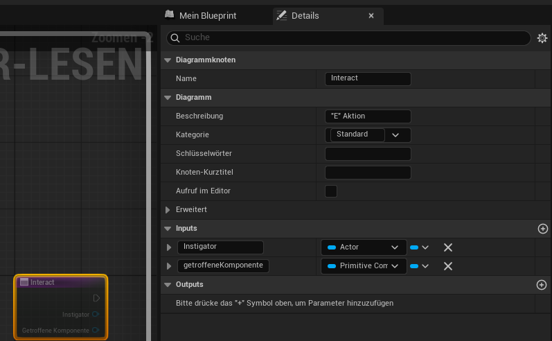

# BPI_Interactable

Ein Unreal-Engine-Blueprint-Interface für einheitliche Interaktionen mit spielweltischen Objekten. Dieses Interface definiert die Kommunikationsstruktur zwischen dem Interaktionssystem und interaktiven Akteuren wie Fritteuse, Kühlschrank oder Spülmaschine.

> **Projektstatus:** Übungsprojekt im Aufbau. Weitere Medien und Dokumentationen werden ergänzt.

## Überblick

Das Interface `BPI_Interactable` stellt ein standardisiertes Interaktionssystem zur Verfügung, das es Spieler:innen ermöglicht, mit Objekten in der Spielwelt zu interagieren. Die Funktion `Interact` wird aufgerufen, wenn eine Interaktion ausgelöst wird (z. B. durch Tastendruck „E").

Jeder Actor, der mit diesem Interface ausgestattet wird, muss die Funktion `Interact` implementieren. Diese Funktion erhält Informationen über die auslösende Entity und die getroffene Komponente, um entsprechend zu reagieren.

## Funktion

### Interact

Die Funktion `Interact` ist die zentrale Interaktionsfunktion des Interfaces.

**ToolTip:** „E" Aktion

**Eingaben:**
- **Instigator** (Actor)  
  Der Actor, der die Interaktion auslöst (normalerweise der Spieler-Charakter).

- **getroffeneKomponente** (Primitive Component)  
  Die Komponente des interaktiven Objekts, die von der Interaktion betroffen ist. Dies ermöglicht es, verschiedene Teile eines Actors unterschiedlich zu behandeln (z. B. linke vs. rechte Tür, Haube vs. Blätter).

**Ausgaben:** Keine direkt; die Implementierung bestimmt die Aktion.

## Technische Details

- **Kategorie:** Standard
- **Schnittstelle:** Blueprint-Interface
- **Parameter-Übergabe:** 
  - Auslöser-Information (`Instigator`)
  - Komponenten-Information (`getroffeneKomponente`)

## Implementierung in Actors

Actors, die das Interface `BPI_Interactable` implementieren, müssen die Funktion `Interact` überschreiben. Dies geschieht üblicherweise im EventGraph des Blueprints:

1. Event `Interact` wird ausgelöst
2. Die getroffene Komponente wird überprüft
3. Basierend auf der Komponente werden verschiedene Aktionen ausgeführt

**Beispiele im Projekt:**
- **BP_Fritteuse:** Reaktion auf Schalter, Knöpfe, Türen und Heizstäbe
- **BP_DoppelKuehlSchrank:** Reaktion auf linke und rechte Tür
- **BP_SpuelMaschine:** Reaktion auf Haube und Waschblätter

## Screenshots

### 1. Interface-Details

Übersicht über die Funktion `Interact` mit ihren Eingabeparametern (`Instigator` und `getroffeneKomponente`) und Metadaten.

## Verwendung

### In einem neuen Actor-Blueprint

1. **Interface hinzufügen:**
   - Öffne den Blueprint-Editor
   - Im Class Defaults Panel: Suche nach „Interfaces"
   - Klicke auf „Add" und wähle `BPI_Interactable`

2. **Event implementieren:**
   - Öffne den EventGraph
   - Klicke auf „Event Interact" oder nutze die Suchfunktion
   - Implementiere die gewünschte Logik

3. **Komponenten prüfen:**
   - Nutze den Parameter `getroffeneKomponente`
   - Verwende Branch- oder Switch-Knoten zur Verzweigung
   - Führe unterschiedliche Aktionen basierend auf der Komponente durch

### Aufruf durch das Interaktionssystem

Das Interaktionssystem des Projekts ruft die Funktion `Interact` auf, wenn:
- Der Spieler die Interaktionstaste drückt (Standard: „E")
- Der Spieler auf einen Actor mit diesem Interface schaut/zielt
- Die Distanz zum Object innerhalb der Interaktionsreichweite liegt

## Videos

### 1. Interface-Definition und Verwendung

Übersicht über die Definition des Interfaces und seine Verwendung in verschiedenen Actors.

[Platzhalter für Video/GIF: Interface-Verwendung]

## Voraussetzungen

- **Unreal-Engine-Version:** Unreal Engine 5.8.4
- Das Interface `BPI_Interactable` muss vorhanden sein
- Ein Interaktionssystem in der Spielwelt (z. B. PlayerCharacter mit Ray-Casting)
- Actors müssen das Interface implementieren, um interaktiv zu sein

## Best Practices

1. **Klare Komponentenbenennung:** Verwende aussagekräftige Namen für Komponenten, damit die Prüfung in `Interact` eindeutig ist.
2. **Sichere Komponentenprüfung:** Überprüfe immer, ob `getroffeneKomponente` gültig ist, bevor du darauf zugreifst.
3. **Wiederverwendbarkeit:** Nutze das Interface konsistent für alle interaktiven Objekte.
4. **Dokumentation:** Dokumentiere, welche Komponenten welche Aktionen auslösen.

## Hinweise

Das Interface selbst enthält keine Implementierungslogik – es definiert lediglich die Schnittstelle. Die konkrete Ausführung liegt in den Hands der implementierenden Actors.

Ein standardisiertes Interface ermöglicht es, das Interaktionssystem zu vereinheitlichen und neue interaktive Objekte schnell hinzuzufügen.
