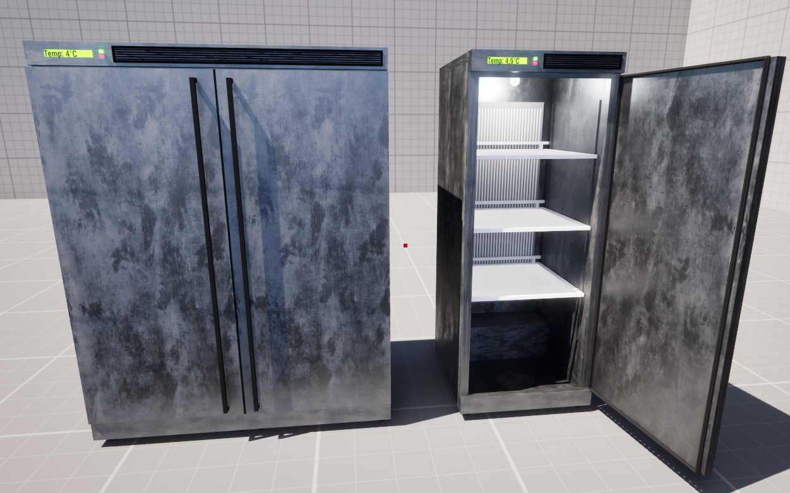
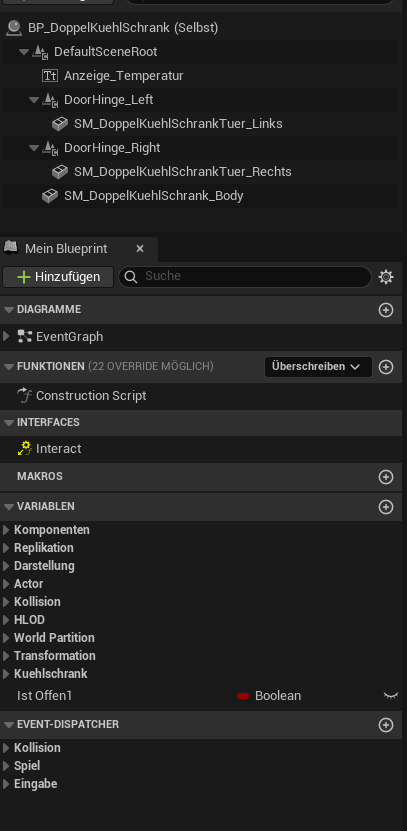
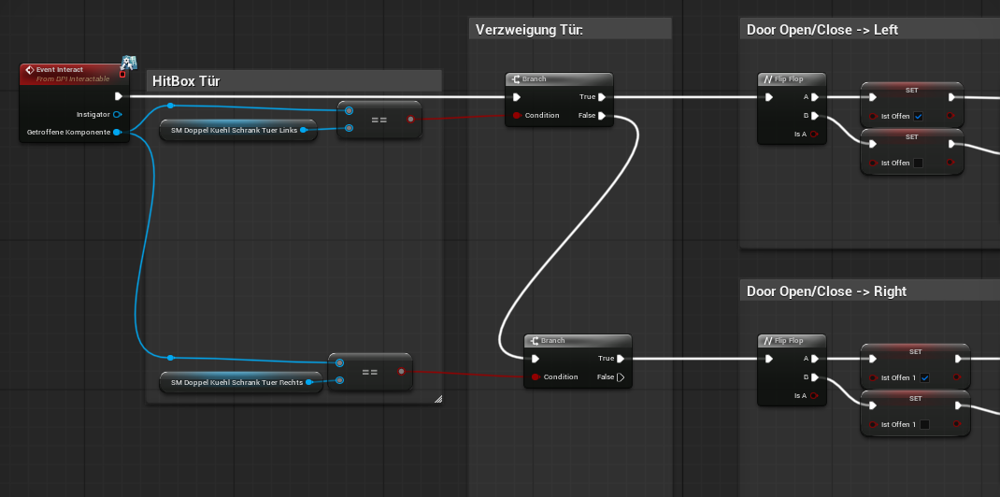
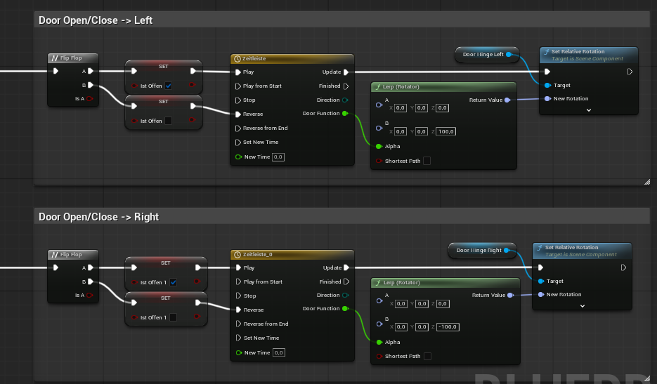
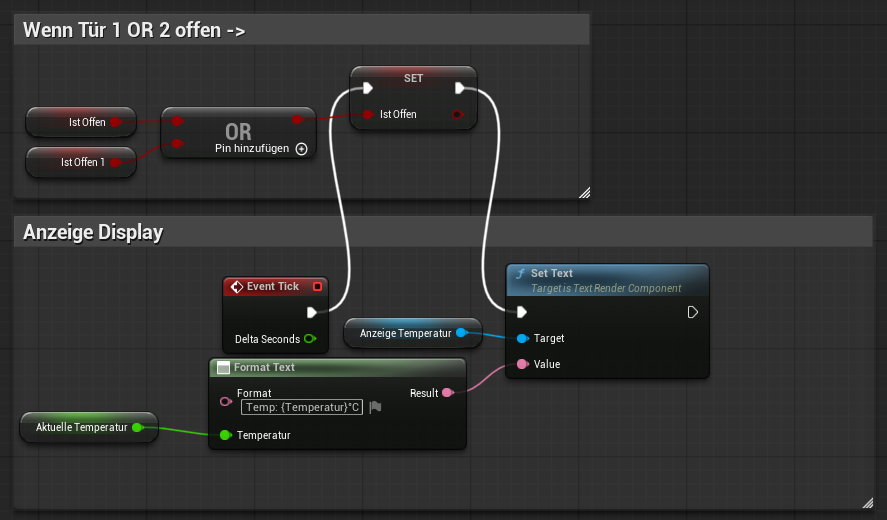

# BP_DoppelKuehlSchrank

Ein Unreal-Engine-Lernprojekt: ein interaktiver Doppel-Kühlschrank mit zwei separat bedienbaren Türen und einer Temperaturanzeige, die über Blueprint und C++ gesteuert wird.

> **Projektstatus:** Übungsprojekt im Aufbau. Weitere Medien und Dokumentationen werden ergänzt.

## Überblick

Der Blueprint `BP_DoppelKuehlSchrank` nutzt das Unreal-Blueprint-Interface `BPI_Interactable` und dessen Funktion `Interact`, um die linke und die rechte Kühlschranktür interaktiv zu öffnen und zu schließen.

Anhand der getroffenen Komponente wird ermittelt, welche Tür betätigt wurde. Die Türen werden mithilfe von FlipFlop-Knoten und Timelines animiert. Der jeweilige Zustand wird in den Variablen `bIstOffen` (linke Tür) und `Ist Offen1` (rechte Tür) gespeichert.

Die aktuelle Temperatur wird über die C++-Klasse `ALogic_Kuehlschrank` bereitgestellt und im Blueprint über eine Text-Render-Komponente als Display angezeigt.

Die Implementierung in [Logic_Kuehlschrank.cpp](Logic_Kuehlschrank.cpp) übernimmt die zeitgesteuerte Temperaturänderung und die Begrenzung der Temperaturwerte. Die zugehörigen Variablen und ihre Blueprint-Zugriffe sind in [Logic_Kuehlschrank.h](Logic_Kuehlschrank.h) definiert.

## Funktionen

- **Türen:** Linke und rechte Tür lassen sich unabhängig voneinander öffnen und schließen.
- **Temperaturanzeige:** Das Display zeigt die aktuelle Temperatur im Format `Temp: {Temperatur}°C`.
- **Temperaturverhalten:** Die Temperatur steigt bei geöffneter Tür bis zu einem Maximalwert und sinkt bei geschlossener Tür bis zu einem Minimalwert.

## Technische Umsetzung

- **Blueprint:** `BP_DoppelKuehlSchrank`
- **C++-Klasse:** `ALogic_Kuehlschrank` (abgeleitet von `AActor`), deklariert in [Logic_Kuehlschrank.h](Logic_Kuehlschrank.h) und implementiert in [Logic_Kuehlschrank.cpp](Logic_Kuehlschrank.cpp)
- **Interaktion:** Unreal-Blueprint-Interface `BPI_Interactable` mit der Funktion `Interact`
- **Komponentenprüfung:** Vergleich der getroffenen Komponente mit `SM_DoppelKuehlSchrankTuer_Links` bzw. `SM_DoppelKuehlSchrankTuer_Rechts`
- **Verzweigungslogik:** Zwei Branch-Knoten nacheinander (zuerst linke, dann rechte Tür)
- **Zustandswechsel:** FlipFlop-Knoten setzen die Türvariablen abwechselnd auf wahr und falsch
- **Animation:** Je Tür eine Timeline, Rotationsinterpolation (`Lerp (Rotator)`) und `Set Relative Rotation`
- **Drehpunkte:** Eigene Komponenten `DoorHinge_Left` und `DoorHinge_Right` als Rotationsachsen der Türen
- **Display:** `Event Tick` setzt per `Set Text` den mit `Format Text` erzeugten Text auf die Komponente `Anzeige_Temperatur`
- **Türzustand für die Temperatur:** `bIstOffen` wird bei jedem Tick mit dem Ergebnis aus `bIstOffen` OR `Ist Offen1` überschrieben (Tür 1 oder 2 offen)

### Temperaturberechnung in C++

- **Initialisierung:** `BeginPlay` begrenzt die Starttemperatur mit `FMath::Clamp` auf den Bereich zwischen `MinimalTemperatur` und `MaxTemperatur` und setzt den internen Zeitzähler zurück.
- **Zeitsteuerung:** `Tick` addiert die vergangene Frame-Zeit `DeltaTime` zu `TimerAkkumulator`. Sobald `Intervall` erreicht ist, wird einmal die Temperatur angepasst und der Zähler auf `0` gesetzt. Es handelt sich um einen Tick-basierten Akkumulator, nicht um einen Unreal-Timer.
- **Geöffnete Tür:** Bei `bIstOffen == true` steigt die Temperatur um `TemperaturSchritt`. `FMath::Min` begrenzt sie auf `MaxTemperatur`.
- **Geschlossene Tür:** Andernfalls sinkt die Temperatur um `TemperaturSchritt`. `FMath::Max` begrenzt sie auf `MinimalTemperatur`.
- **Rundung:** Nach der Anpassung wird die Temperatur mit `FMath::RoundToFloat` auf eine Nachkommastelle gerundet.

Mit den Standardwerten startet der Kühlschrank bei `4,0 °C`. Die Temperatur ändert sich pro erreichtem Intervall von `3 Sekunden` um `0,3 °C` und bewegt sich zwischen `4,0 °C` und `20,0 °C`. Dies ist ein vereinfachtes Temperaturmodell für das Lernprojekt, keine physikalisch genaue Simulation.

### Variablen in `Logic_Kuehlschrank.h` (Kategorie `Kuehlschrank`)

| Variable | Typ | Standardwert | Zugriff im Blueprint | Beschreibung |
| --- | --- | --- | --- | --- |
| `bIstOffen` | `bool` | `false` | lesen und schreiben | Steuert, ob die Tür offen ist |
| `AktuelleTemperatur` | `float` | `4.0` | nur lesen | Aktuelle Temperatur |
| `MaxTemperatur` | `float` | `20.0` | lesen und schreiben | Maximale Temperatur bei geöffneter Tür |
| `MinimalTemperatur` | `float` | `4.0` | lesen und schreiben | Minimale Temperatur bei geschlossener Tür |
| `TemperaturSchritt` | `float` | `0.3` | lesen und schreiben | Temperaturänderung pro Intervall (°C) |
| `Intervall` | `float` | `3.0` | lesen und schreiben | Zeit in Sekunden zwischen Temperaturänderungen |
| `TimerAkkumulator` | `float` | `0.0` | privat | Interner Zähler |

## Screenshots

### 1. Komponentenstruktur

Übersicht über die Komponenten des `BP_DoppelKuehlSchrank`-Actors mit Anzeige, Türen, Drehpunkten und Body.

### 2. Interaktionslogik

Einstiegspunkt über das Event `Interact` des Interfaces `BPI_Interactable` sowie die Prüfung der getroffenen Komponente (HitBox Tür) und die Verzweigung für die linke und die rechte Tür.

### 3. Actor-Aufbau und Drehpunkte

Türanimation für links und rechts: FlipFlop setzt den Türzustand, die Timeline steuert über `Lerp (Rotator)` die Rotation des jeweiligen Drehpunkts (`DoorHinge_Left` bzw. `DoorHinge_Right`).

### 4. Displayanzeige

Der Türzustand wird per OR-Knoten aus beiden Türen ermittelt. Auf dem Display wird die aktuelle Temperatur angezeigt.

## Videos

### 1. Blueprint-EventGraph

Übersicht über den vollständigen EventGraph und die Umsetzung der Türsteuerung und der Temperaturanzeige.

<video src="resources/eventgraph.mp4" controls width="100%"></video>

### 2. Interaktionen im Viewport

Vorführung des Kühlschranks in der laufenden Unreal-Engine-Szene mit geöffneten und geschlossenen Türen und der Temperaturanzeige.

<video src="resources/vorschau.mp4" controls width="100%"></video>
[Video ansehen](./resources/vorschau.mp4)

## Voraussetzungen und Verwendung

- **Unreal-Engine-Version:** Unreal Engine 5.8.4
- Das Interface `BPI_Interactable` muss im Projekt vorhanden sein.
- Die C++-Klasse `ALogic_Kuehlschrank` muss im Projekt kompiliert sein.
- Die C++-Dateien verwenden das Modul-Makro `SPIELWIESE_API`. Bei einer Übernahme in ein anderes Unreal-C++-Projekt muss dieses zum jeweiligen Modul passen.
- `BP_DoppelKuehlSchrank` muss in einer passenden Szene platziert werden.
- Die Interaktion erfolgt über das im Projekt vorhandene Interaktionssystem.
- Die konkrete Eingabe bzw. Taste wird durch das Interaktionssystem vorgegeben.

## Was ich dabei umgesetzt habe

- Interaktionen über ein Blueprint-Interface
- Erkennung der linken und rechten Tür anhand der getroffenen Komponente
- Einrichtung eigener Drehpunkte für die beweglichen Türen
- Steuerung animierter Türbewegungen mit Timelines
- Umsetzung von Zustandswechseln mit FlipFlop-Knoten
- Anbindung einer C++-Klasse mit Blueprint-Variablen
- Implementierung einer intervallbasierten Temperaturänderung mit `DeltaTime` in C++
- Begrenzung und Rundung von Temperaturwerten mit `FMath`
- Anzeige der aktuellen Temperatur über eine Text-Render-Komponente

## Hinweise

Bei diesem Repository handelt es sich um eine Dokumentation des Übungsprojekts. Die Screenshots und Videos veranschaulichen den Aufbau und die Funktionsweise der Blueprints.

Ein Export des EventGraphs ersetzt nicht das vollständige Unreal-Engine-Projekt mit seinen Meshes, Materialien und weiteren Abhängigkeiten.
