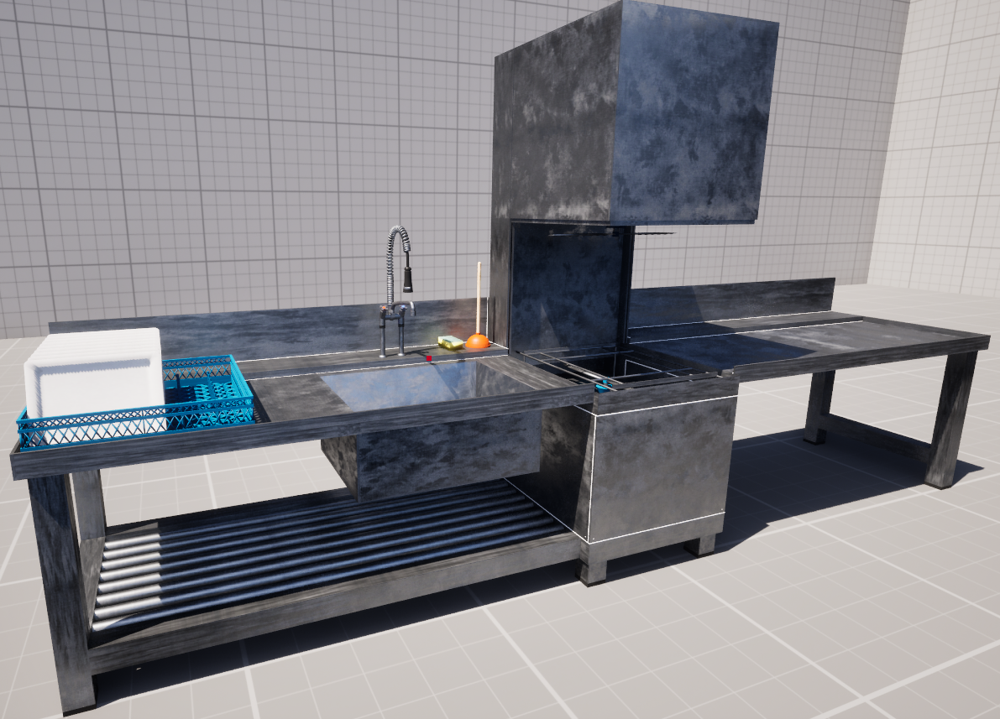
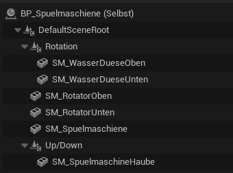
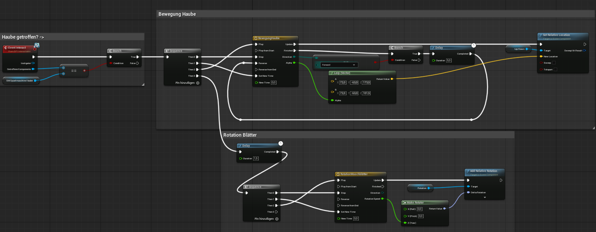
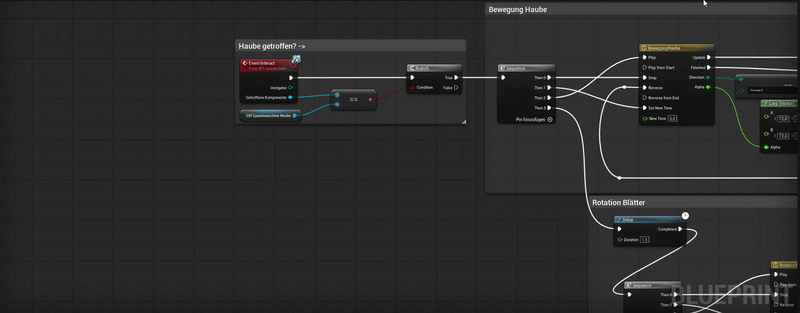
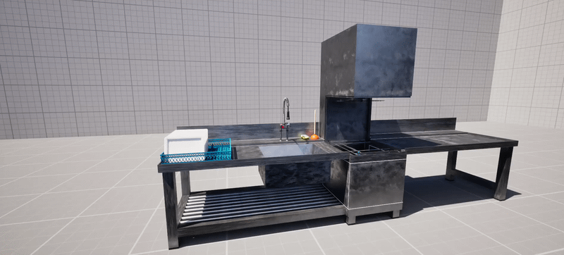

# BP_SpuelMaschine

Ein Unreal-Engine-Lernprojekt: eine interaktive Spülmaschine, deren Haube sich öffnen und schließen lässt sowie deren Waschblätter rotieren können, gesteuert durch Blueprints.

> **Projektstatus:** Übungsprojekt im Aufbau. Weitere Medien und Dokumentationen werden ergänzt.

## Überblick

Der Blueprint `BP_SpuelMaschine` nutzt das Unreal-Blueprint-Interface `BPI_Interactable` und dessen Funktion `Interact`, um die Haube der Spülmaschine interaktiv zu öffnen und zu schließen.

Anhand der getroffenen Komponente wird ermittelt, ob die Haube betätigt wurde. Die Öffnungs- und Schließbewegung wird mithilfe einer Timeline animiert, die die Haube nach oben und unten bewegt. Die Waschblätter rotieren unabhängig davon durchgehend.

## Funktionen

- **Haube:** Lässt sich öffnen und schließen mit animierter Auf- und Abwärtsbewegung.
- **Waschblätter:** Rotieren kontinuierlich um die vertikale Achse (Z-Achse).
- **Zustandsverwaltung:** Der aktuelle Status der Haube wird gespeichert und gesteuert.

## Technische Umsetzung

- **Blueprint:** `BP_SpuelMaschine`
- **Interaktion:** Unreal-Blueprint-Interface `BPI_Interactable` mit der Funktion `Interact`
- **Komponentenprüfung:** Vergleich der getroffenen Komponente mit `SM_SpuelmaschineHaube`
- **Hauenbewegung:** 
  - Timeline namens `BewegungHaube` steuert die vertikale Bewegung
  - Vektorinterpolation (`VLerp`) für sanfte Auf- und Abbewegung
  - `Set Relative Location` wendet die neue Position auf die Komponente `Up/Down` an
  - Verkehrte Richtung bei Rückbewegung (Rücksprung nach oben)
  - Eine Verzögerung (`Delay`) sorgt für Wartezeit vor erneutem Betätigen
- **Blätterrotation:**
  - Timeline namens `RotationWaschblätter` steuert kontinuierliche Rotation
  - `Make Rotator` erstellt eine Rotator-Struktur mit Y-Achsenrotation
  - `Add Relative Rotation` wendet die Rotation auf die Komponente `Rotation` an
  - Läuft kontinuierlich während der Ausführung ab
- **Drehpunkte/Komponenten:**
  - `Up/Down` – Bewegungskomponente der Haube
  - `Rotation` – Komponente der rotierenden Waschblätter

## Screenshots

### 1. Komponentenstruktur

Übersicht über die Komponenten des `BP_SpuelMaschine`-Actors mit der Rotation (Waschblätter), den Türen der Wasserdüsen, dem Rotator-Element und der Haube sowie der Spülmaschine selbst.

### 2. EventGraph

Einstiegspunkt über das Event `Interact` des Interfaces `BPI_Interactable`, Überprüfung der Haube, Verzweigung für Auf- und Abbewegung mit entsprechenden Timelines, Verzögerung zur Steuerung des Betätigungsintervalls sowie die gleichzeitige Rotation der Waschblätter.

## Videos

### 1. Blueprint-EventGraph

Übersicht über den vollständigen EventGraph und die Umsetzung der Haubenbewegung und Blätterrotation.

### 2. Interaktionen im Viewport

Vorführung der Spülmaschine in der laufenden Unreal-Engine-Szene mit der Haubenbewegung und rotierenden Waschblättern.

## Voraussetzungen und Verwendung

- **Unreal-Engine-Version:** Unreal Engine 5.8.4
- Das Interface `BPI_Interactable` muss im Projekt vorhanden sein.
- `BP_SpuelMaschine` muss in einer passenden Szene platziert werden.
- Die Interaktion erfolgt über das im Projekt vorhandene Interaktionssystem.
- Die konkrete Eingabe bzw. Taste wird durch das Interaktionssystem vorgegeben.

## Was ich dabei umgesetzt habe

- Interaktionen über ein Blueprint-Interface
- Erkennung der Haube anhand der getroffenen Komponente
- Steuerung animierter Haubenbewegungen mit Timelines
- Vektorinterpolation für sanfte Auf- und Abbewegungen
- Kontinuierliche Rotation von Komponenten mit Rotator-Strukturen
- Verzögerungsmechanismus zur Steuerung des Interaktionsintervalls
- Zustandsverwaltung für mehrstufige Animationen

## Hinweise

Bei diesem Repository handelt es sich um eine Dokumentation des Übungsprojekts. Die Screenshots und Videos veranschaulichen den Aufbau und die Funktionsweise der Blueprints.

Ein Export des EventGraphs ersetzt nicht das vollständige Unreal-Engine-Projekt mit seinen Meshes, Materialien und weiteren Abhängigkeiten.
